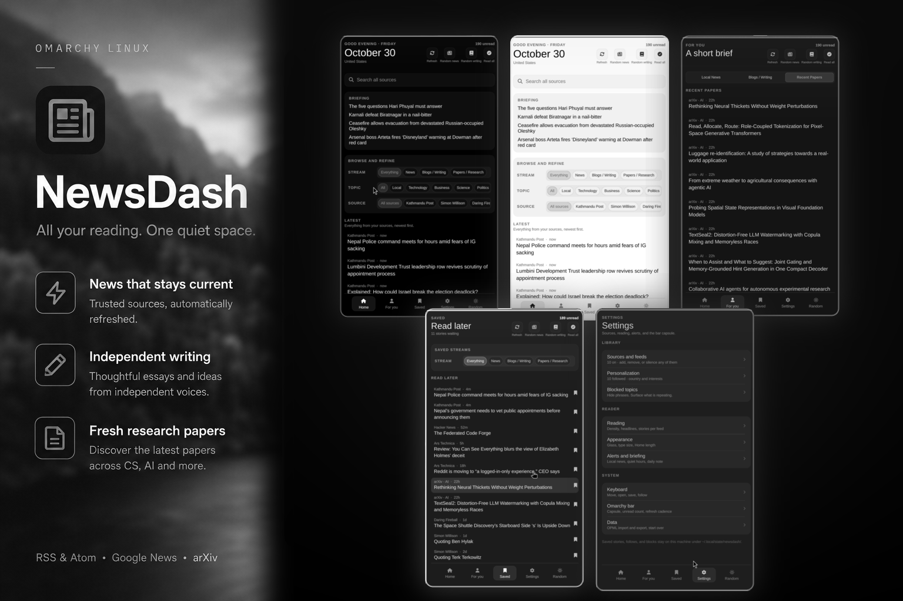
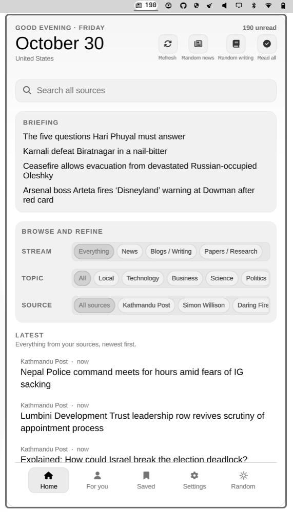
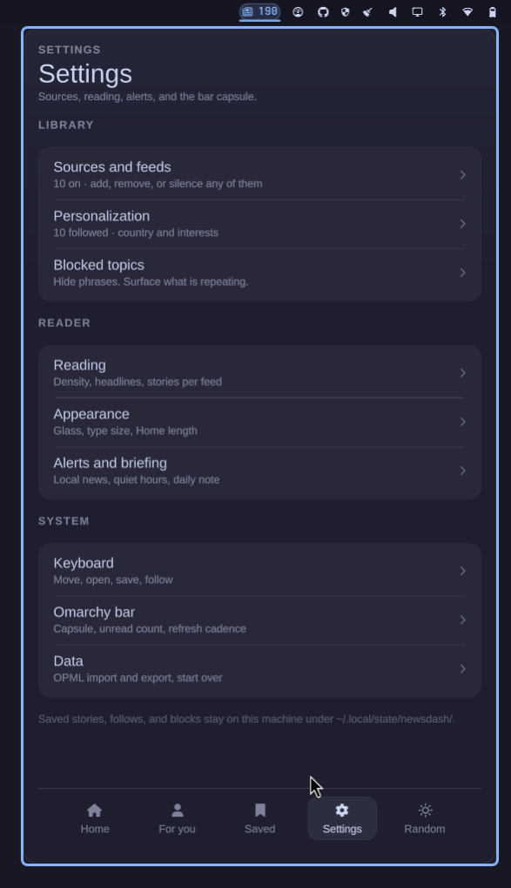
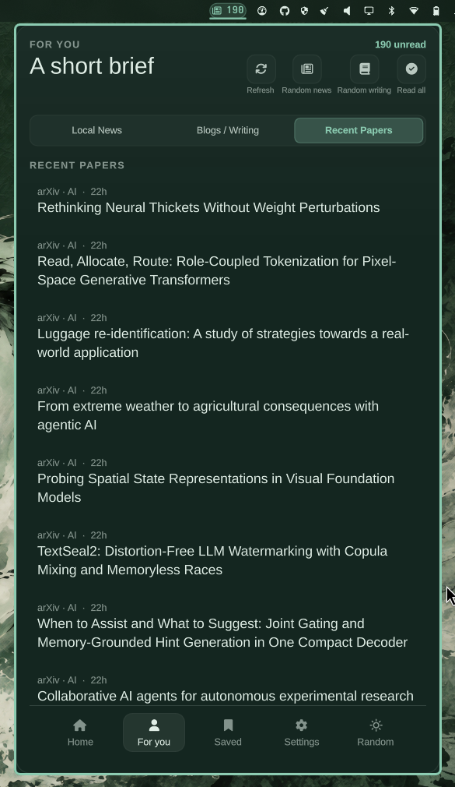
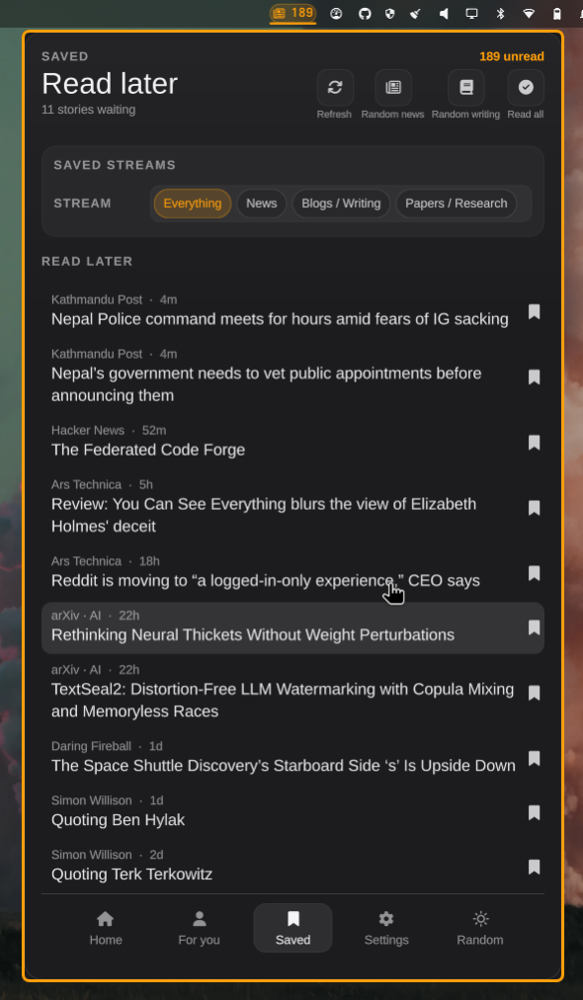

# NewsDash

A unified Omarchy / Quickshell news reader: RSS and Atom feeds in one quiet panel.



## Features

- **Bar capsule** - unread count pill with adaptive theming
- **Home** - greeting, date, search, category tabs and per-category source filters
- **For you** - stories from followed sources only
- **Saved** - local read-later list, persisted on disk
- **Settings** - sources and feeds, personalization, blocked topics, reading, alerts, appearance, keyboard, bar and data
- **First-run setup** - pick interests and 50+ curated feeds across tech, business, science, politics, world, sports, culture, blogs, local and linux
- **Local / regional defaults** - Onlinekhabar, BBC Nepali, Kathmandu Post and more
- **Favorite blogs** - Simon Willison, Daring Fireball, Paul Graham essays and more
- Adaptive dark/light theming via Omarchy palette tokens
- Keyboard shortcuts, async fetch, graceful errors and persistent state under `~/.local/state/newsdash/`

## Screenshots

<table>
  <tr>
    <td align="center"><br><b>White</b> - Home</td>
    <td align="center"><br><b>Catppuccin</b> - Settings</td>
  </tr>
  <tr>
    <td align="center"><br><b>Osaka Jade</b> - For you</td>
    <td align="center"><br><b>Starship</b> - Saved</td>
  </tr>
</table>

## Install

```bash
omarchy plugin add https://github.com/paudelsamir/newsdash.git --enable
omarchy restart shell
```

Or run the helper:

```bash
./install.sh
```

## Remove

```bash
omarchy plugin remove paudelsamir.newsdash --yes
omarchy restart shell
```

Or run the helper:

```bash
./remove.sh
```

Your saved state stays at `~/.local/state/newsdash/`. Delete that folder manually if you want a clean slate.

## Bar

| Click | Action |
|-------|--------|
| Left | Open panel |
| Right | Refresh now |
| Middle | Mark all read |

## Panel keys

| Key | Action |
|-----|--------|
| 1-4 | Home, For you, Saved, Settings |
| h / l, left / right | Previous / next page |
| r | Refresh |
| m | Mark visible as read |
| o | Open top story |
| u | Undo mark-read |
| Esc | Back / close |

## Data

Everything stays on the machine:

- `~/.local/state/newsdash/state.json` - articles, read map, saved, follows, blocks, prefs

The state folder is created with mode `0700` and the file with mode `0600`, so other local accounts cannot read your reading history or preferences.

## Layout

```
BarWidget.qml          bar capsule + data owner
NewsDashboard.qml      panel shell (nav + pages)
newsEngine.js          fetch, parse, state helpers
catalog.js             50+ curated feeds by category
components/            Card, Chip, NavBar, ArticleRow, ...
pages/                 Home, For you, Saved, Settings, Setup
views/                 Sources, Personalization, Blocked, Reading, Alerts, Keyboard, Bar
```

MIT. See [LICENSE](LICENSE).
